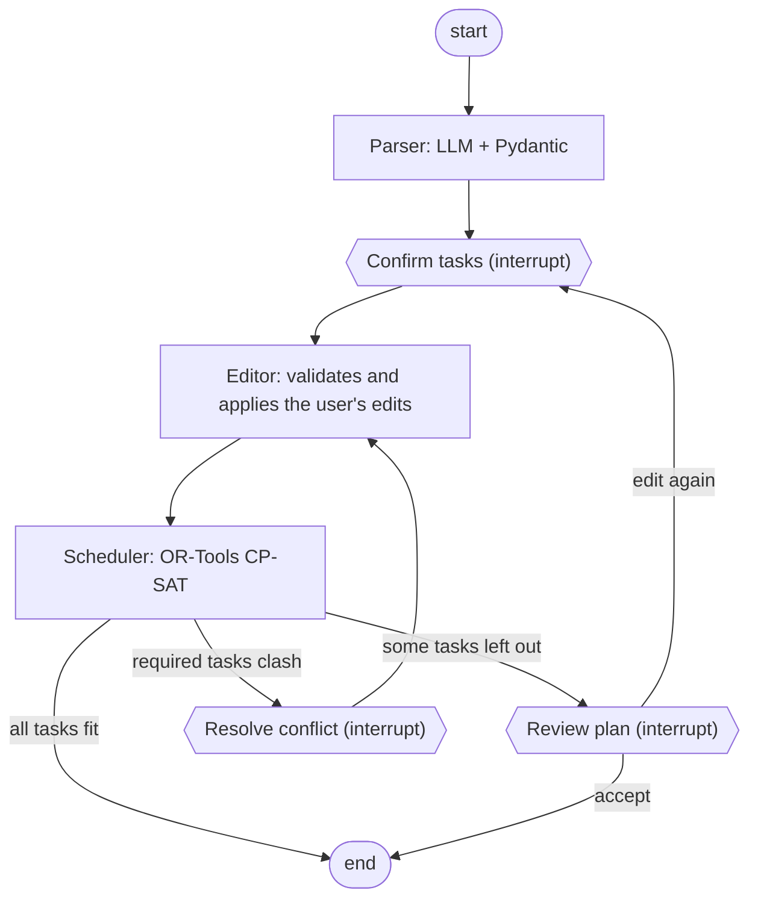

# agentic-day-planner

Local-first agentic day planner: describe your day in plain language and get an optimized schedule.
LangGraph + Ollama + OR-Tools CP-SAT, 100% free stack.

## What it does

You write something like *"domani devo studiare 2 ore, dentista alle 15, se riesco la spesa"*
(*"tomorrow I have to study for 2 hours, dentist at 3pm, groceries if I can"*), and the planner:

1. **Parses** the sentence with a local LLM into tasks with duration, priority, whether they are
   required, and time constraints (fixed start, not before, deadline).
2. **Asks you to check them** in an editable table: you can change duration, priority (1–5),
   required, and times before anything is scheduled.
3. **Schedules** the confirmed tasks with a constraint solver (OR-Tools CP-SAT): no overlaps,
   time windows respected, higher priorities first, impossible tasks left out instead of
   breaking the plan.
4. **Asks again only if the plan differs from what you confirmed**:
   - all tasks fit: done, no more questions;
   - some tasks don't fit: you see which ones and accept, or go back and edit;
   - required tasks clash (the day is impossible): you see only those tasks and fix them
     (drop the requirement, move a time, shorten), then the solver tries again.

It is an *agentic workflow*: a LangGraph graph of steps with the user in the loop, not a
multi-agent system.

## How it works



| Step | Role | Uses LLM? |
|------|------|-----------|
| **Parser** | Turns the sentence into validated tasks. The LLM writes the source fragment of each task first (grounding), times are converted in Python, made-up times are removed with a warning, invalid tasks are rejected with a reason | Yes |
| **Confirm tasks** | Pauses the graph (`interrupt`) and shows a JSON summary; the answer contains only the changed fields and is validated with a Pydantic `response_schema` | No |
| **Editor** | Applies the edits with full validation; unknown tasks or edits that would make a task impossible are skipped with a warning | No |
| **Scheduler** | Builds the schedule with CP-SAT: constraints are guaranteed, not hallucinated. When required tasks clash it finds the minimal set of clashing tasks | No |
| **Routing** | A conditional edge reads the solver's result: end, review or conflict | No |
| **Resolve conflict** | Pauses with only the clashing required tasks; the answer is an ordinary edit, applied by the same editor, and the solver runs again | No |
| **Review plan** | Pauses only when some tasks were left out: accept ends the graph, edit loops back to the confirmation, starting from the tasks already edited | No |

### Design choices

- **The solver does the hard part.** Scheduling is a constraint problem, so CP-SAT handles it and
  the LLM only does the language part. This is why a small local model (Qwen2.5 7B) is enough.
- **The user decides, the graph applies.** The interface only collects choices; validation and
  rules live in the graph, so any caller (web UI, future API, future agent) behaves the same.
- **Never fail silently.** Removed times, skipped edits and rejected tasks always come with a
  warning or a reason.
- **100% free and local-first.** Ollama for the LLM, everything runs on your machine.
- **Model-agnostic.** A single `LLMClient` interface (Ollama or LangChain) selected from `.env`.

## Installation

Requirements: Python 3.11+ (developed on 3.13) and [Ollama](https://ollama.com).

```bash
git clone <repo-url>
cd agentic-day-planner

python -m venv .venv
# Windows: .venv\Scripts\activate    macOS/Linux: source .venv/bin/activate

python -m pip install -e ".[dev,ui]"

ollama pull qwen2.5:7b
cp .env.example .env    # Windows: copy .env.example .env
```

Settings (model, Ollama host, context size, temperature...) are in `.env`; the defaults work with
a local Ollama. Docker and PostgreSQL are not needed yet: they are for the planned database and
memory.

## Usage

Start Ollama, then the interface:

```bash
python -m streamlit run src/planner/ui/app.py
```

It opens at <http://localhost:8501>:

1. Write your day and press **Enter** (or *Pianifica*).
2. Check the tasks: edit the table and press *Conferma e pianifica*, or *Continua senza modifiche*.
3. Look at the plan: *Continua senza modifiche* to accept it, *Modifica i task* to go back.

On a GTX 1060 6GB the parser takes about 10–12 seconds per sentence; the solver is instant.
The interface is in Italian, like the parser prompt.

### Tests and evaluation

```bash
python -m pytest                    # unit tests, no LLM needed (fake client)
python -m ruff check src tests
python tests/eval/run_eval.py       # parser evaluation on real cases, needs Ollama
```

## Project structure

```
src/planner/
  agents/   parser, state, graph, approval (summaries), editor
  solver/   Pydantic models and CP-SAT scheduler
  llm/      LLMClient interface, Ollama and LangChain clients, factory
  ui/       Streamlit interface and edit diffing
  config.py settings from .env
tests/
  unit/     unit and graph tests (FakeClient, InMemorySaver)
  eval/     parser evaluation cases and script
```

## Status and roadmap

Working: parser, user confirmation and edits, scheduler, conflict resolution, plan review loop,
Streamlit interface.

Next:

- **Database** (PostgreSQL) and a node that saves the accepted plan
- **Memory** with pgvector: preferences and past days
- **FastAPI** and `.ics` export
- Model comparison on the same evaluation set

See [TODO.md](TODO.md) for details and design decisions.

## License

MIT
