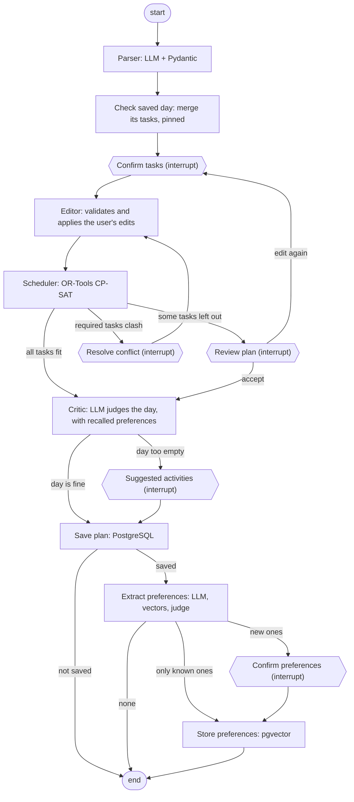

# agentic-day-planner

Local-first agentic day planner: describe your day in plain language and get an optimized schedule,
saved day by day, with a memory of your preferences.
LangGraph + Ollama + OR-Tools CP-SAT + PostgreSQL/pgvector, 100% free stack.

## What it does

You pick a day and write something like *"devo studiare 2 ore, la mattina mi concentro meglio,
dentista alle 15"* (*"I have to study for 2 hours, I focus better in the morning, dentist at 3pm"*),
and the planner:

1. **Parses** the sentence with a local LLM into tasks with duration, priority, whether they are
   required, and time constraints (fixed start, not before, deadline).
2. **Checks the database**: if that day already has a saved plan, its tasks stay where they are
   and the new ones are added in the free time (or you can replace the saved plan).
3. **Asks you to check the tasks** in an editable table: duration, priority (1–5), required and
   times can be changed before anything is scheduled. Tasks already saved are shown apart, read only.
4. **Schedules** them with a constraint solver (OR-Tools CP-SAT): no overlaps, time windows
   respected, higher priorities first, impossible tasks left out instead of breaking the plan.
5. **Asks again only if the plan differs from what you confirmed**:
   - some tasks don't fit: you see which ones and accept, or go back and edit;
   - required tasks clash (the day is impossible): you see only those tasks and fix them,
     then the solver tries again.
6. **Reviews the day with a critic**: an LLM judges the finished plan, taking into account the
   weekday and the remembered preferences closest to the day's tasks, and if the day looks too
   empty proposes activities (physical activity, study, rest...).
7. **Saves** the day to PostgreSQL.
8. **Remembers your preferences**: the LLM looks for preferences in the sentence ("la mattina mi
   concentro meglio" → *preferisce studiare la mattina*), you confirm which ones to keep, and they
   are stored as vectors with pgvector. Next to a new preference you see the saved ones that are
   close, and can delete one that no longer holds.

It is an *agentic workflow*: a LangGraph graph of steps with the user in the loop, not a
multi-agent system.

## How it works



| Step | Role | Uses LLM? |
|------|------|-----------|
| **Parser** | Turns the sentence into validated tasks. The LLM writes the source fragment of each task first (grounding), times are converted in Python, made-up times are removed with a warning, invalid tasks are rejected with a reason | Yes |
| **Check saved day** | Reads the database right after the parser: if the date has a plan, its tasks join the new ones, pinned at their times for the solver (their data is saved back unchanged) | No |
| **Confirm tasks** | Pauses the graph (`interrupt`) and shows a JSON summary; the answer contains only the changed fields and is validated with a Pydantic `response_schema`. It can also ask to replace the saved plan instead of merging | No |
| **Editor** | Applies the edits with full validation; unknown tasks, saved tasks and edits that would make a task impossible are skipped with a warning | No |
| **Scheduler** | Builds the schedule with CP-SAT: constraints are guaranteed, not hallucinated. When required tasks clash it finds the minimal set of clashing tasks | No |
| **Routing** | Conditional edges read the solver's result: critic, review or conflict | No |
| **Resolve conflict** | Pauses with only the clashing required tasks; the answer is an ordinary edit, applied by the same editor, and the solver runs again | No |
| **Review plan** | Pauses only when some tasks were left out: accept goes on, edit loops back to the confirmation, starting from the tasks already edited | No |
| **Critic** | Python computes the free slots, the busy time and the weekday of the chosen date; the LLM receives them as facts with the 3 remembered preferences closest to the tasks, writes its assessment *before* deciding whether the day is too empty, and proposes activities; proposals that fit no free slot are dropped | Yes |
| **Save plan** | Saves the day with the tasks that are in the plan (the ones left out are listed in the message, not saved), or rewrites it in one transaction if the date was already saved | No |
| **Extract preferences** | Only for a saved day. The LLM writes the source, then the cue that makes it a preference (not a commitment), then the text; Python drops the ones not grounded in the sentence. Each one is compared by vector with the saved ones, and an LLM judge decides whether a close one says the same thing | Yes |
| **Confirm preferences** | Pauses only for new preferences: the user picks which to keep and can delete close saved ones | No |
| **Store preferences** | Saves the kept ones with their vector, counts the known ones again, deletes the chosen ones | No |

### Design choices

- **The solver does the hard part.** Scheduling is a constraint problem, so CP-SAT handles it and
  the LLM only does the language part. This is why a small local model (Qwen2.5 7B) is enough.
- **Numbers from Python, words from the LLM.** The critic never counts minutes or guesses the
  weekday: free time and the date are computed in Python, shown to the user as data, and the
  model's comment is shown as an opinion.
- **Vectors rank, the LLM and the user decide.** Measured with `nomic-embed-text`, embeddings see
  the topic, not the details: *"studiare la mattina"* and *"studiare la sera"* are closer than many
  real paraphrases, and no similarity threshold separates the preferences relevant to a task from
  the others. So vectors only pick the candidates; an LLM judge decides whether two preferences
  are the same, and the user resolves contradictions.
- **The user confirms what is remembered.** A wrong preference would affect every future day:
  the model extracts, the user decides.
- **The user decides, the graph applies.** The interface only collects choices; validation and
  rules live in the graph, so any caller (web UI, future API, future agent) behaves the same.
- **LLM calls and questions in separate nodes.** A resumed node restarts from the beginning, so a
  node with an `interrupt` never calls the LLM or writes to the database.
- **Never fail silently.** Removed times, skipped edits, dropped suggestions, rejected tasks and
  preferences always come with a warning or a reason.
- **The database is the last line of defence.** The rules of the models are repeated as SQL
  constraints (one day per date, durations, priorities, time windows, vector size), and a day is
  saved in one transaction: all or nothing.
- **Measured, not guessed.** LLM and embedding behaviour is measured with scripts on development
  and held-out cases before it shapes the design (`tests/eval/`).
- **100% free and local-first.** Ollama for the LLM and the embeddings, PostgreSQL with pgvector
  in Docker, everything on your machine.
- **Model-agnostic.** `LLMClient` and `Embedder` interfaces, selected from `.env`.

## Installation

Requirements: Python 3.11+ (developed on 3.13), [Ollama](https://ollama.com) and
[Docker](https://www.docker.com/products/docker-desktop/) (for the database).

```bash
git clone <repo-url>
cd agentic-day-planner

python -m venv .venv
# Windows: .venv\Scripts\activate    macOS/Linux: source .venv/bin/activate

python -m pip install -e ".[dev,ui]"

ollama pull qwen2.5:7b              # the LLM
ollama pull nomic-embed-text        # the embedding model for the preferences
cp .env.example .env                # Windows: copy .env.example .env

docker compose up -d                # PostgreSQL + pgvector on port 5433
python -m alembic upgrade head      # creates the tables
```

Settings (models, Ollama host, context size, temperature, database URL...) are in `.env`; the
defaults work with a local Ollama and the Docker database.

## Usage

Start Ollama and Docker **first**, then the interface:

```bash
python -m streamlit run src/planner/ui/app.py
```

It opens at <http://localhost:8501>:

1. Pick the day (tomorrow by default), write what you have to do and press **Enter**.
2. Check the tasks, edit the table if needed, and press *Conferma e pianifica*. If the day already
   has a plan, its tasks are shown apart: the new ones are added in the free time, or press
   *Sostituisci il piano salvato* to replace it.
3. If some tasks don't fit, accept the plan or go back to the tasks.
4. Read the critic's comment, the preferences it considered and, if the day looks empty, its
   suggestions.
5. If the sentence expressed a preference, confirm which ones to remember. The results of saving
   are shown at the bottom.

The buttons next to the title open **📅 Storico** (the saved days with their plans) and
**🧠 Preferenze** (the remembered preferences, each one can be deleted). Days older than two
weeks are deleted when the app starts; preferences are kept.

Without the database the planner still works, but plans and preferences are not saved (a warning
says so); as soon as the database answers, the app uses it. On a GTX 1060 6GB each LLM call takes
about 5–15 seconds; the solver and the embeddings are fast. The interface is in Italian, like the
prompts. After changing the code, restart Streamlit: the graph is cached.

### Database

The schema is managed with **Alembic** (plain SQL revisions in `src/planner/db/migrations/versions`):
tables `days`, `tasks` and `preferences` (with a `vector(768)` column), the `day_summary` view and
the `purge_old_days` procedure.

```bash
python -m alembic current              # revision of the database
python -m alembic upgrade head         # apply the missing revisions
python -m alembic upgrade head --sql   # print the SQL without running it
python -m alembic downgrade -1         # undo the last revision
```

To look at the data, open `psql` in the container:

```bash
docker exec -it planner-db psql -U planner -d planner
```

or connect a client (for example the PostgreSQL extension for VS Code) to `localhost:5433`,
user `planner`, password `planner`, database `planner`.

To reset:

| Goal | Command |
|------|---------|
| delete one day (its tasks go with it) | `DELETE FROM days WHERE day_date = '2026-11-03';` |
| delete the remembered preferences | `DELETE FROM preferences;` |
| empty all tables | `TRUNCATE days, preferences RESTART IDENTITY CASCADE;` |
| rebuild the schema | `python -m alembic downgrade base` then `python -m alembic upgrade head` |
| start from scratch | `docker compose down -v`, `docker compose up -d`, `python -m alembic upgrade head` |

### Tests and evaluation

```bash
python -m pytest                          # all tests; no LLM needed (fake client and embedder)
python -m ruff check src tests
python tests/eval/run_eval.py             # parser evaluation on real cases, needs Ollama
python tests/eval/run_preferences.py      # preference extraction and duplicate judge
python tests/eval/run_preferences.py --holdout   # held-out cases, never used to tune the prompt
python tests/eval/run_embeddings.py       # similarities behind the vector thresholds
```

The integration tests use a separate `planner_test` database in the same container, created and
migrated automatically; every test is rolled back at the end. If Docker is off they are skipped.

## Project structure

```
src/planner/
  agents/   parser, state, graph, approval (summaries), editor, critic, merge (saved days),
            preferences (extraction, duplicate judge, recall)
  solver/   Pydantic models and CP-SAT scheduler
  llm/      LLMClient and Embedder interfaces, Ollama and LangChain clients, factory
  db/       store and preferences (SQL), repository (what the graph uses), Alembic migrations
  ui/       Streamlit interface and edit diffing
  dates.py  dates in Italian
  config.py settings from .env
tests/
  unit/        unit and graph tests (fake client, embedder and repositories, InMemorySaver)
  integration/ database tests on planner_test
  eval/        evaluation cases and measurement scripts (need Ollama)
```

## Status and roadmap

Working: parser, user confirmation and edits, scheduler, conflict resolution, plan review, day
critic with suggestions, PostgreSQL storage with merge or replace of a saved day, history and
purge of old days, memory of preferences with pgvector, Streamlit interface.

Next:

- **Interface**: a clearer, more guided interface
- **Preferences**: review when they are saved, review the vector search, make the critic's use
  of them more reliable
- **FastAPI** and `.ics` export
- Model comparison on the same evaluation set

See [TODO.md](TODO.md) for details and design decisions, and [CHANGELOG.md](CHANGELOG.md) for
the releases.

## License

MIT
