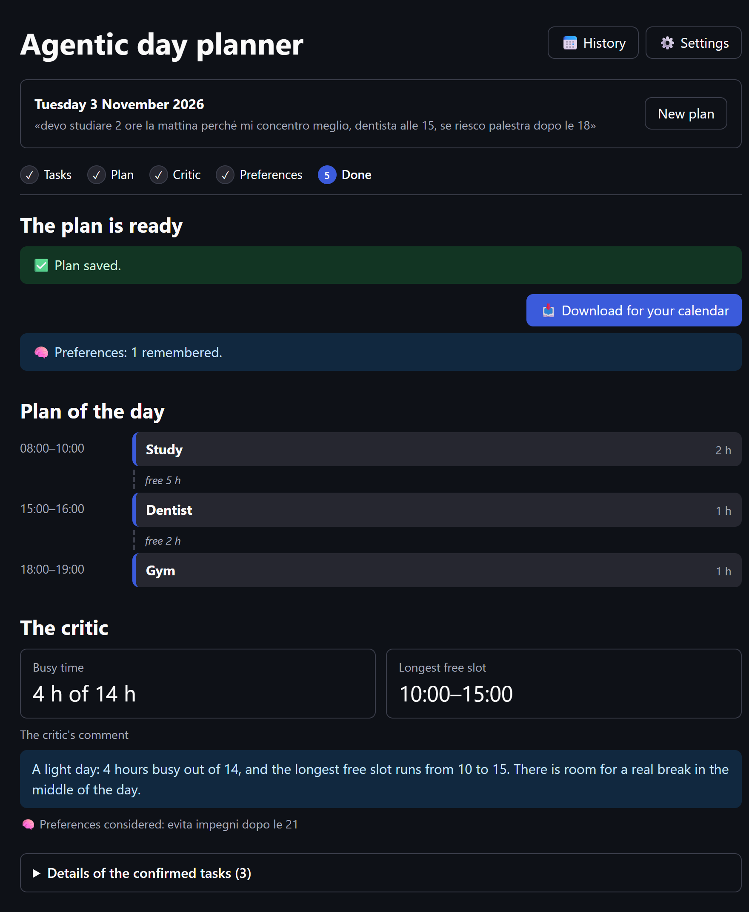
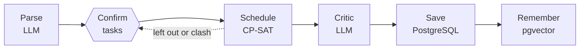
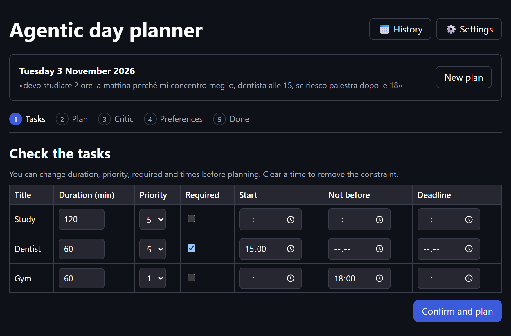
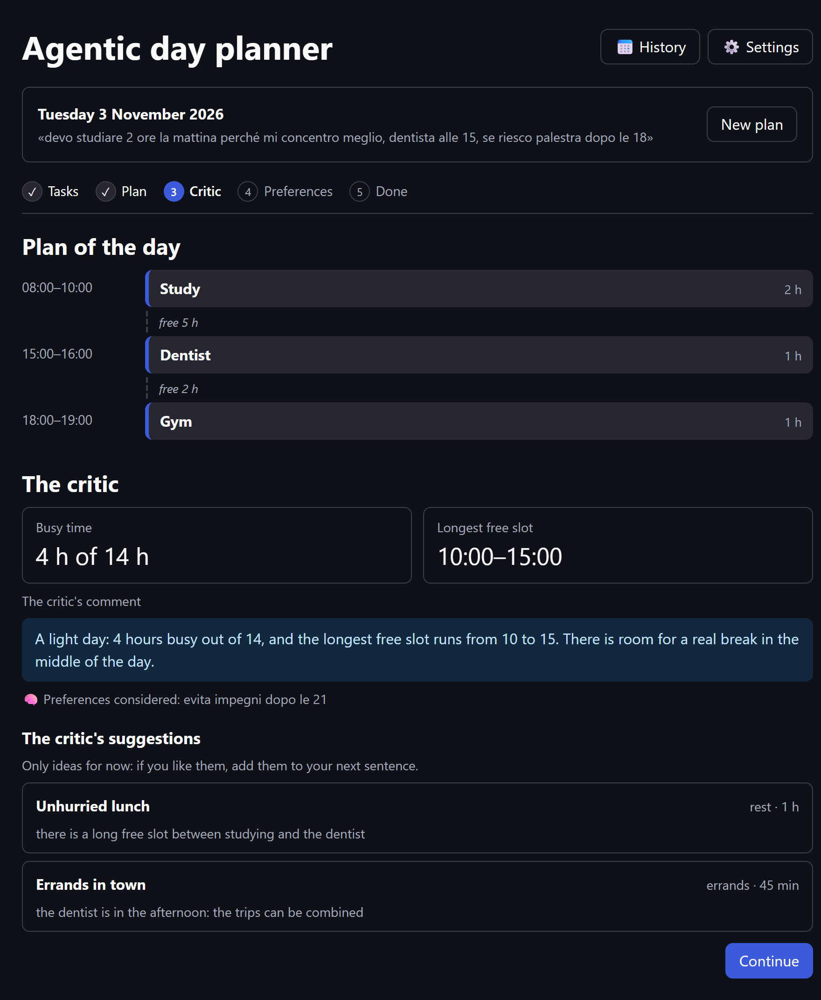
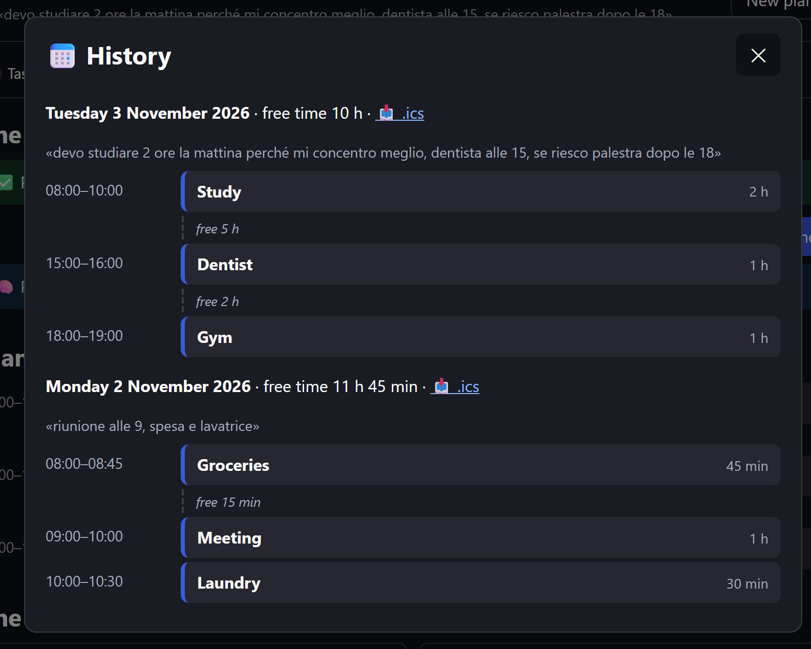
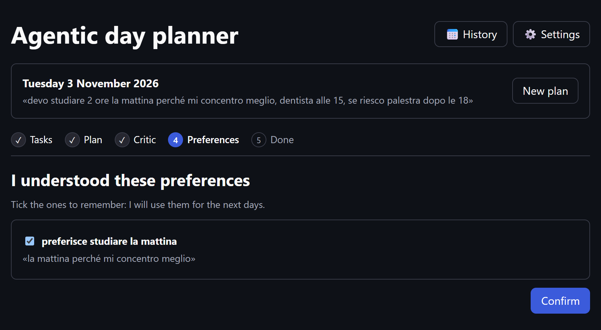
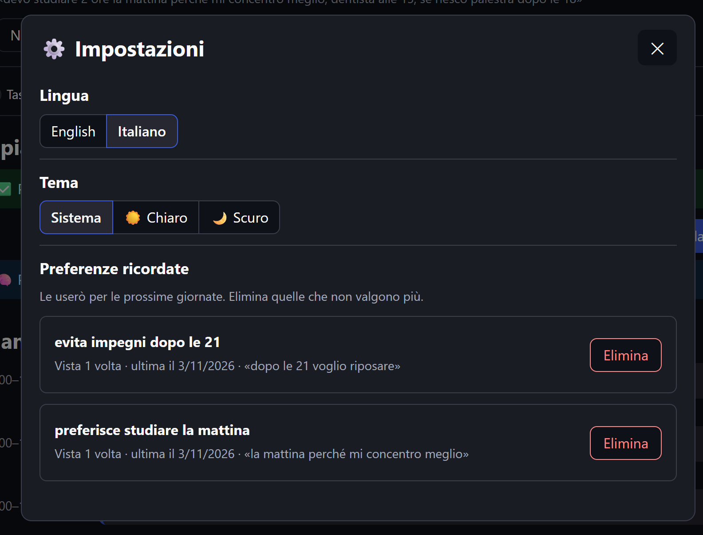

# agentic-day-planner

Local-first agentic day planner: describe your day in plain language and get an optimized schedule,
saved day by day, with a memory of your preferences.
LangGraph + Ollama + OR-Tools CP-SAT + PostgreSQL/pgvector, 100% free stack.

Want to study these technologies? The [booklet in `docs/`](docs/README.md) (in Italian) explains each
one through this project's code, including the mistakes made along the way.

<p align="center">
  
</p>

## Contents

- [What it does](#what-it-does)
- [How it works](#how-it-works) · [Design choices](#design-choices)
- [Installation](#installation)
- [Usage](#usage) · [API](#api) · [Database](#database) · [Tests and evaluation](#tests-and-evaluation)
- [Project structure](#project-structure)
- [Status and roadmap](#status-and-roadmap)
- [License](#license)

## What it does

You pick a day and write something like *"devo studiare 2 ore, la mattina mi concentro meglio,
dentista alle 15"* (*"I have to study for 2 hours, I focus better in the morning, dentist at 3pm"*),
and the planner:

1. **Parses** the sentence with a local LLM into tasks with duration, priority, whether they are
   required, and time constraints (fixed start, not before, deadline).
2. **Checks the database**: if that day already has a saved plan, its tasks stay where they are
   and the new ones are added in the free time (or you can replace the saved plan).
3. **Asks you to check the tasks** in an editable table: duration, priority (1–5), required and
   times can be changed before anything is scheduled. Tasks already saved are shown apart, read only.
4. **Schedules** them with a constraint solver (OR-Tools CP-SAT): no overlaps, time windows
   respected, higher priorities first, impossible tasks left out instead of breaking the plan.
5. **Asks again only if the plan differs from what you confirmed**:
   - some tasks don't fit: you see which ones and accept, or go back and edit;
   - required tasks clash (the day is impossible): you see only those tasks and fix them,
     then the solver tries again.
6. **Reviews the day with a critic**: an LLM judges the finished plan, taking into account the
   weekday and the remembered preferences closest to the day's tasks, and if the day looks too
   empty proposes activities (physical activity, study, rest...).
7. **Saves** the day to PostgreSQL.
8. **Remembers your preferences**: the LLM looks for preferences in the sentence ("la mattina mi
   concentro meglio" → *preferisce studiare la mattina*), you confirm which ones to keep, and they
   are stored as vectors with pgvector. Next to a new preference you see the saved ones that are
   close, and can delete one that no longer holds.

It is an *agentic workflow*: a LangGraph graph of steps with the user in the loop, not a
multi-agent system.

## How it works



Hexagons are the points where the graph stops and asks the user (`interrupt`): the tasks are
confirmed before scheduling, and the plan comes back to the user only if some task is left out
or required tasks clash. The critic may propose activities, and new preferences are confirmed
before they are remembered.

<details>
<summary><strong>The full graph and every step</strong></summary>


| Step | Role | Uses LLM? |
|------|------|-----------|
| **Parser** | Turns the sentence into validated tasks. The LLM writes the source fragment of each task first (grounding), times are converted in Python, made-up times are removed with a warning, invalid tasks are rejected with a reason | Yes |
| **Check saved day** | Reads the database right after the parser: if the date has a plan, its tasks join the new ones, pinned at their times for the solver (their data is saved back unchanged) | No |
| **Confirm tasks** | Pauses the graph (`interrupt`) and shows a JSON summary; the answer contains only the changed fields and is validated with a Pydantic `response_schema`. It can also ask to replace the saved plan instead of merging | No |
| **Editor** | Applies the edits with full validation; unknown tasks, saved tasks and edits that would make a task impossible are skipped with a warning | No |
| **Scheduler** | Builds the schedule with CP-SAT: constraints are guaranteed, not hallucinated. When required tasks clash it finds the minimal set of clashing tasks | No |
| **Routing** | Conditional edges read the solver's result: critic, review or conflict | No |
| **Resolve conflict** | Pauses with only the clashing required tasks; the answer is an ordinary edit, applied by the same editor, and the solver runs again | No |
| **Review plan** | Pauses only when some tasks were left out: accept goes on, edit loops back to the confirmation, starting from the tasks already edited | No |
| **Critic** | Python computes the free slots, the busy time and the weekday of the chosen date; the LLM receives them as facts with the 3 remembered preferences closest to the tasks, writes its assessment *before* deciding whether the day is too empty, and proposes activities; proposals that fit no free slot are dropped | Yes |
| **Save plan** | Saves the day with the tasks that are in the plan (the ones left out are listed in the message, not saved), or rewrites it in one transaction if the date was already saved | No |
| **Extract preferences** | Only for a saved day. The LLM writes the source, then the cue that makes it a preference (not a commitment), then the text; Python drops the ones not grounded in the sentence. Each one is compared by vector with the saved ones, and an LLM judge decides whether a close one says the same thing | Yes |
| **Confirm preferences** | Pauses only for new preferences: the user picks which to keep and can delete close saved ones | No |
| **Store preferences** | Saves the kept ones with their vector, counts the known ones again, deletes the chosen ones | No |

</details>

### Design choices

- **The solver does the hard part.** Scheduling is a constraint problem, so CP-SAT handles it and
  the LLM only does the language part. This is why a small local model (Qwen2.5 7B) is enough.
- **Numbers from Python, words from the LLM.** The critic never counts minutes or guesses the
  weekday: free time and the date are computed in Python, shown to the user as data, and the
  model's comment is shown as an opinion.
- **Vectors rank, the LLM and the user decide.** Measured with `nomic-embed-text`, embeddings see
  the topic, not the details: *"studiare la mattina"* and *"studiare la sera"* are closer than many
  real paraphrases, and no similarity threshold separates the preferences relevant to a task from
  the others. So vectors only pick the candidates; an LLM judge decides whether two preferences
  are the same, and the user resolves contradictions.
- **The user confirms what is remembered.** A wrong preference would affect every future day:
  the model extracts, the user decides.
- **The user decides, the graph applies.** The interface only collects choices; validation and
  rules live in the graph, so any caller (the web page, another API client, a future agent)
  behaves the same.
- **LLM calls and questions in separate nodes.** A resumed node restarts from the beginning, so a
  node with an `interrupt` never calls the LLM or writes to the database.
- **Never fail silently.** Removed times, skipped edits, dropped suggestions, rejected tasks and
  preferences always come with a warning or a reason.
- **The database is the last line of defence.** The rules of the models are repeated as SQL
  constraints (one day per date, durations, priorities, time windows, vector size), and a day is
  saved in one transaction: all or nothing.
- **Measured, not guessed.** LLM and embedding behaviour is measured with scripts on development
  and held-out cases before it shapes the design (`tests/eval/`).
- **100% free and local-first.** Ollama for the LLM and the embeddings, PostgreSQL with pgvector
  in Docker, everything on your machine.
- **Model-agnostic.** `LLMClient` and `Embedder` interfaces, selected from `.env`.

## Installation

Requirements: Python 3.11+ (developed on 3.13), [Ollama](https://ollama.com) and
[Docker](https://www.docker.com/products/docker-desktop/) (for the database).

```bash
git clone <repo-url>
cd agentic-day-planner

python -m venv .venv
# Windows: .venv\Scripts\activate    macOS/Linux: source .venv/bin/activate

python -m pip install -e ".[dev]"

ollama pull qwen2.5:7b              # the LLM
ollama pull nomic-embed-text        # the embedding model for the preferences
cp .env.example .env                # Windows: copy .env.example .env

docker compose up -d                # PostgreSQL + pgvector on port 5433
python -m alembic upgrade head      # creates the tables
```

Settings (models, Ollama host, context size, temperature, database URL...) are in `.env`; the
defaults work with a local Ollama and the Docker database.

**Speed: keep the model on the GPU.** After a first plan, run `ollama ps`: the PROCESSOR column
should say `100% GPU`. Ollama estimates the memory it needs with a wide margin and, on a 6 GB card,
leaves part of `qwen2.5:7b` on the CPU, which slows every token down. If you see a CPU share, set
`LLM_NUM_GPU=99` in `.env` to put every layer on the GPU. Measured on a GTX 1060 6GB:

| `.env` | Where the model runs | Tokens/s | Parser, per sentence |
|---|---|---|---|
| `LLM_NUM_CTX=8192`, `LLM_NUM_GPU` unset | 21% CPU / 79% GPU | 11 | 13.0 s |
| `LLM_NUM_CTX=4096` (default), `LLM_NUM_GPU=99` | 100% GPU, with `nomic-embed-text` too | 22–24 | 8.6 s |

Same answers on the parser evaluation (8/13 cases, same per-field scores). Do not lower
`LLM_NUM_CTX` below what the prompts need (the parser reads ~860 tokens and writes ~200): beyond
the limit Ollama cuts the text without any error. `LLM_KEEP_ALIVE` (default `30m`) keeps the models
loaded between plans, so the next one does not wait for a reload. If the model no longer loads
after setting `LLM_NUM_GPU`, the card is too small (or busy with other programs): remove it.

## Usage

Start Ollama and Docker **first**, then the API, which also serves the web page:

```bash
python -m uvicorn planner.api.app:app --reload
```

Open <http://127.0.0.1:8000/>:

1. Pick the day (tomorrow by default), write what you have to do **in Italian** and press
   **Enter**. The form closes into one line with the day and the sentence; the steps at the top
   (Tasks → Plan → Critic → Preferences → Done) show where you are.
2. Check the tasks, edit the table if needed, and press *Confirm and plan*. If the day already
   has a plan, its tasks are shown apart: the new ones are added in the free time, or press
   *Replace the saved plan* to replace it.
3. If some tasks don't fit, accept the plan or go back to the tasks.
4. Read the critic's comment, the preferences it considered and, if the day looks empty, its
   suggestions.
5. If the sentence expressed a preference, confirm which ones to remember.
6. The final screen starts with the outcome and **📥 Download for your calendar** (an `.ics` file for
   Outlook, Google Calendar or the phone), then the plan as a timeline and the critic.

<table>
  <tr>
    <td width="50%"></td>
    <td width="50%"></td>
  </tr>
  <tr>
    <td align="center"><em>Check the tasks before anything is scheduled</em></td>
    <td align="center"><em>The critic: numbers from Python, the comment from the LLM</em></td>
  </tr>
  <tr>
    <td></td>
    <td></td>
  </tr>
  <tr>
    <td align="center"><em>📅 History: the saved days</em></td>
    <td align="center"><em>Confirm what is remembered</em></td>
  </tr>
  <tr>
    <td colspan="2" align="center"></td>
  </tr>
  <tr>
    <td colspan="2" align="center"><em>⚙️ Settings, here with Italian selected: the whole page follows the language</em></td>
  </tr>
</table>

The screenshots come from the real page, driven by a script with scripted LLM answers.

Next to the title, **📅 History** shows the saved days with their plans, and **⚙️ Settings** holds
the language, the theme (*System*, *Light* or *Dark*; *System* follows the operating system) and
the remembered preferences, each of which can be deleted. *New plan* starts again, and asks first
if a plan is in progress. Days older than two weeks are deleted when the API starts; preferences
are kept.

Without the database the planner still works, but plans and preferences are not saved (a warning
says so); start Docker and restart the API to use it. With the model all on the GPU of a GTX 1060
6GB, each LLM call takes about 3–10 seconds; the solver and the embeddings are fast. A Streamlit
interface was available up to v0.3.0.

**Languages.** The interface is in English or Italian, chosen in ⚙️ Settings (each language by
its own name, no flags: a flag stands for a country, not a language). English is the default and
the choice is remembered. The page asks the API for its messages in the same language with the
`Accept-Language` header, so warnings, saving and errors follow it, also after a switch in the
middle of a plan. The model writes task titles and the critic's comment in that language too: a
line at the end of the prompts names those fields, while the copied source stays Italian (the
checks on made-up times read it) and so do the remembered preferences (one language keeps the
vector search reliable). Sentences are still written in Italian, as the English page says.

### API

<http://127.0.0.1:8000/docs> is the interactive documentation. The web page is one client of the
API; any program can plan a day the same way. A plan is a conversation of a few requests:

| Request | What it does |
|---------|--------------|
| `GET /health` | whether the API is up and the database answered at startup |
| `POST /plans` with `{"text": ..., "day_date": "2026-11-03"}` | starts the graph; returns a `thread_id` and the first question (`step`) |
| `POST /plans/{thread_id}/resume` with `{"answer": {...}}` | answers the question; returns the next one, or `"step": "done"` with plan, critique and save result |
| `GET /days/{day_date}/plan.ics` | the saved plan of a day as an iCalendar file, to import into any calendar app (404 if the day has no plan, 503 without the database) |
| `GET /days` | the saved days, most recent first, each with its plan |
| `GET /preferences`, `DELETE /preferences/{id}` | the remembered preferences; delete one (204, or 404 if it does not exist) |

The answer has the format of the question: `{"edits": {}}` to confirm the tasks,
`{"accept": true}` for the plan review, `{"accepted": [0]}` for the suggestions,
`{"keep": [0], "delete": []}` for the preferences. Invalid answers get a 422 and the question
stays open; an unknown `thread_id` gets a 404, a finished plan a 409. Paused plans live in memory:
they are lost when the server restarts. Days older than two weeks are deleted at startup (`/health`
says how many), and without the database plans are not saved; if the database stops answering
later, requests that need it get a 503.

The calendar events are in the time zone set by `TIMEZONE` in `.env` (default `Europe/Rome`); each
event has a stable UID (date + task id), so a calendar can tell a re-imported event from a new one.

### Database

The schema is managed with **Alembic** (plain SQL revisions in `src/planner/db/migrations/versions`):
tables `days`, `tasks` and `preferences` (with a `vector(768)` column), the `day_summary` view and
the `purge_old_days` procedure.

```bash
python -m alembic current              # revision of the database
python -m alembic upgrade head         # apply the missing revisions
python -m alembic upgrade head --sql   # print the SQL without running it
python -m alembic downgrade -1         # undo the last revision
```

To look at the data, open `psql` in the container:

```bash
docker exec -it planner-db psql -U planner -d planner
```

or connect a client (for example the PostgreSQL extension for VS Code) to `localhost:5433`,
user `planner`, password `planner`, database `planner`.

To reset:

| Goal | Command |
|------|---------|
| delete one day (its tasks go with it) | `DELETE FROM days WHERE day_date = '2026-11-03';` |
| delete the remembered preferences | `DELETE FROM preferences;` |
| empty all tables | `TRUNCATE days, preferences RESTART IDENTITY CASCADE;` |
| rebuild the schema | `python -m alembic downgrade base` then `python -m alembic upgrade head` |
| start from scratch | `docker compose down -v`, `docker compose up -d`, `python -m alembic upgrade head` |

### Tests and evaluation

```bash
python -m pytest                          # all tests; no LLM needed (fake client and embedder)
python -m ruff check src tests
python tests/eval/run_eval.py             # parser evaluation on real cases, needs Ollama
python tests/eval/run_preferences.py      # preference extraction and duplicate judge
python tests/eval/run_preferences.py --holdout   # held-out cases, never used to tune the prompt
python tests/eval/run_embeddings.py       # similarities behind the vector thresholds
```

The integration tests use a separate `planner_test` database in the same container, created and
migrated automatically; every test is rolled back at the end. If Docker is off they are skipped.

## Project structure

```
src/planner/
  agents/   parser, state, graph, approval (summaries), editor, critic, merge (saved days),
            preferences (extraction, duplicate judge, recall)
  solver/   Pydantic models and CP-SAT scheduler
  llm/      LLMClient and Embedder interfaces, Ollama and LangChain clients, factory
  db/       store and preferences (SQL), repository (what the graph uses), Alembic migrations
  api/      FastAPI app (endpoints), request/response models, static/ web page (HTML, JS, CSS)
  export/   a saved day as an iCalendar (.ics) file
  messages.py  every sentence written for the user, in Italian and English
  dates.py  dates in Italian
  config.py settings from .env
tests/
  unit/        unit and graph tests (fake client, embedder and repositories, InMemorySaver)
  integration/ database tests on planner_test
  eval/        evaluation cases and measurement scripts (need Ollama)
docs/          booklet on the technologies used, in Italian
```

## Status and roadmap

Working: parser, user confirmation and edits, scheduler, conflict resolution, plan review, day
critic with suggestions, PostgreSQL storage with merge or replace of a saved day, history and
purge of old days, memory of preferences with pgvector, REST API with FastAPI, `.ics` export, and
a web page served by the API.

Next:

- **Interface**: one card per task instead of the table on a phone, editable preference texts
- **Preferences**: review when they are saved, review the vector search, make the critic's use
  of them more reliable
- A PostgreSQL checkpointer, so paused plans survive a restart of the API
- Model comparison on the same evaluation set

See [TODO.md](TODO.md) for details and design decisions, and [CHANGELOG.md](CHANGELOG.md) for
the releases.

## License

MIT
