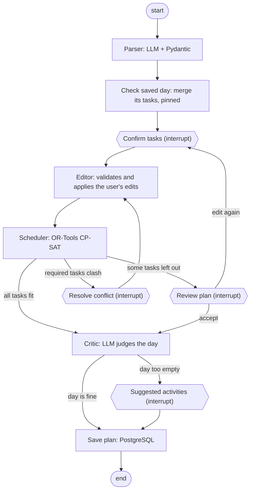

# agentic-day-planner

Local-first agentic day planner: describe your day in plain language and get an optimized schedule,
saved day by day.
LangGraph + Ollama + OR-Tools CP-SAT + PostgreSQL, 100% free stack.

## What it does

You pick a day and write something like *"devo studiare 2 ore, dentista alle 15, se riesco la spesa"*
(*"I have to study for 2 hours, dentist at 3pm, groceries if I can"*), and the planner:

1. **Parses** the sentence with a local LLM into tasks with duration, priority, whether they are
   required, and time constraints (fixed start, not before, deadline).
2. **Checks the database**: if that day already has a saved plan, its tasks stay where they are
   and the new ones are added in the free time (or you can replace the saved plan).
3. **Asks you to check the tasks** in an editable table: duration, priority (1–5), required and
   times can be changed before anything is scheduled. Tasks already saved are shown apart, read only.
4. **Schedules** them with a constraint solver (OR-Tools CP-SAT): no overlaps, time windows
   respected, higher priorities first, impossible tasks left out instead of breaking the plan.
5. **Asks again only if the plan differs from what you confirmed**:
   - some tasks don't fit: you see which ones and accept, or go back and edit;
   - required tasks clash (the day is impossible): you see only those tasks and fix them,
     then the solver tries again.
6. **Reviews the day with a critic**: an LLM judges the finished plan and, if the day looks too
   empty, proposes activities (physical activity, study, rest...).
7. **Saves** the day to PostgreSQL.

It is an *agentic workflow*: a LangGraph graph of steps with the user in the loop, not a
multi-agent system.

## How it works



| Step | Role | Uses LLM? |
|------|------|-----------|
| **Parser** | Turns the sentence into validated tasks. The LLM writes the source fragment of each task first (grounding), times are converted in Python, made-up times are removed with a warning, invalid tasks are rejected with a reason | Yes |
| **Check saved day** | Reads the database right after the parser: if the date has a plan, its tasks join the new ones, pinned at their times for the solver (their data is saved back unchanged) | No |
| **Confirm tasks** | Pauses the graph (`interrupt`) and shows a JSON summary; the answer contains only the changed fields and is validated with a Pydantic `response_schema`. It can also ask to replace the saved plan instead of merging | No |
| **Editor** | Applies the edits with full validation; unknown tasks, saved tasks and edits that would make a task impossible are skipped with a warning | No |
| **Scheduler** | Builds the schedule with CP-SAT: constraints are guaranteed, not hallucinated. When required tasks clash it finds the minimal set of clashing tasks | No |
| **Routing** | Conditional edges read the solver's result: critic, review or conflict | No |
| **Resolve conflict** | Pauses with only the clashing required tasks; the answer is an ordinary edit, applied by the same editor, and the solver runs again | No |
| **Review plan** | Pauses only when some tasks were left out: accept goes on, edit loops back to the confirmation, starting from the tasks already edited | No |
| **Critic** | Python computes the free slots and the busy time; the LLM receives them as facts, writes its assessment *before* deciding whether the day is too empty, and proposes activities; proposals that fit no free slot are dropped | Yes |
| **Save plan** | The only node that writes outside the graph: saves the day with the tasks that are in the plan (the ones left out are listed in the message, not saved), or rewrites it in one transaction if the date was already saved | No |

### Design choices

- **The solver does the hard part.** Scheduling is a constraint problem, so CP-SAT handles it and
  the LLM only does the language part. This is why a small local model (Qwen2.5 7B) is enough.
- **Numbers from Python, words from the LLM.** The critic never counts minutes: free time is
  computed in Python, shown to the user as data, and the model's comment is shown as an opinion.
- **The user decides, the graph applies.** The interface only collects choices; validation and
  rules live in the graph, so any caller (web UI, future API, future agent) behaves the same.
- **LLM calls and questions in separate nodes.** A resumed node restarts from the beginning, so a
  node with an `interrupt` never calls the LLM or writes to the database.
- **Never fail silently.** Removed times, skipped edits, dropped suggestions and rejected tasks
  always come with a warning or a reason.
- **The database is the last line of defence.** The rules of the models are repeated as SQL
  constraints (one day per date, durations, priorities, time windows), and a day is saved in one
  transaction: all or nothing.
- **100% free and local-first.** Ollama for the LLM, PostgreSQL in Docker, everything on your machine.
- **Model-agnostic.** A single `LLMClient` interface (Ollama or LangChain) selected from `.env`.

## Installation

Requirements: Python 3.11+ (developed on 3.13), [Ollama](https://ollama.com) and
[Docker](https://www.docker.com/products/docker-desktop/) (for the database).

```bash
git clone <repo-url>
cd agentic-day-planner

python -m venv .venv
# Windows: .venv\Scripts\activate    macOS/Linux: source .venv/bin/activate

python -m pip install -e ".[dev,ui]"

ollama pull qwen2.5:7b
cp .env.example .env    # Windows: copy .env.example .env

docker compose up -d                # PostgreSQL + pgvector on port 5433
python -m alembic upgrade head      # creates the tables
```

Settings (model, Ollama host, context size, temperature, database URL...) are in `.env`; the
defaults work with a local Ollama and the Docker database.

## Usage

Start Ollama and Docker, then the interface:

```bash
python -m streamlit run src/planner/ui/app.py
```

It opens at <http://localhost:8501>:

1. Pick the day (tomorrow by default), write what you have to do and press **Enter**.
2. Check the tasks, edit the table if needed, and press *Conferma e pianifica*. If the day already
   has a plan, its tasks are shown apart: the new ones are added in the free time, or press
   *Sostituisci il piano salvato* to replace it.
3. If some tasks don't fit, accept the plan or go back to the tasks.
4. Read the critic's comment and, if the day looks empty, its suggestions. The result of saving is
   shown at the bottom.

Without the database the planner still works, but plans are not saved (a warning says so).
On a GTX 1060 6GB each LLM call takes about 10–15 seconds; the solver is instant.
The interface is in Italian, like the prompts.

### Database

The schema is managed with **Alembic** (plain SQL revisions in `src/planner/db/migrations/versions`):

```bash
python -m alembic current              # revision of the database
python -m alembic upgrade head         # apply the missing revisions
python -m alembic upgrade head --sql   # print the SQL without running it
python -m alembic downgrade -1         # undo the last revision
```

To look at the data, open `psql` in the container:

```bash
docker exec -it planner-db psql -U planner -d planner
```

or connect a client (for example the PostgreSQL extension for VS Code) to `localhost:5433`,
user `planner`, password `planner`, database `planner`.

To reset:

| Goal | Command |
|------|---------|
| delete one day (its tasks go with it) | `DELETE FROM days WHERE day_date = '2026-11-03';` |
| empty all tables | `TRUNCATE days RESTART IDENTITY CASCADE;` |
| rebuild the schema | `python -m alembic downgrade base` then `python -m alembic upgrade head` |
| start from scratch | `docker compose down -v`, `docker compose up -d`, `python -m alembic upgrade head` |

### Tests and evaluation

```bash
python -m pytest                    # all tests; no LLM needed (fake client)
python -m ruff check src tests
python tests/eval/run_eval.py       # parser evaluation on real cases, needs Ollama
```

The integration tests use a separate `planner_test` database in the same container, created and
migrated automatically; every test is rolled back at the end. If Docker is off they are skipped.

## Project structure

```
src/planner/
  agents/   parser, state, graph, approval (summaries), editor, critic, merge (saved days)
  solver/   Pydantic models and CP-SAT scheduler
  llm/      LLMClient interface, Ollama and LangChain clients, factory
  db/       store (SQL), repository (what the graph uses), Alembic migrations
  ui/       Streamlit interface and edit diffing
  config.py settings from .env
tests/
  unit/        unit and graph tests (FakeClient, FakePlanRepository, InMemorySaver)
  integration/ database tests on planner_test
  eval/        parser evaluation cases and script
```

## Status and roadmap

Working: parser, user confirmation and edits, scheduler, conflict resolution, plan review, day
critic with suggestions, PostgreSQL storage with merge or replace of a saved day, Streamlit
interface.

Next:

- **Database**: views and stored procedures for statistics on past days, history in the interface
- **Memory** with pgvector: preferences and past days
- **FastAPI** and `.ics` export
- Model comparison on the same evaluation set

See [TODO.md](TODO.md) for details and design decisions, and [CHANGELOG.md](CHANGELOG.md) for
the releases.

## License

MIT
