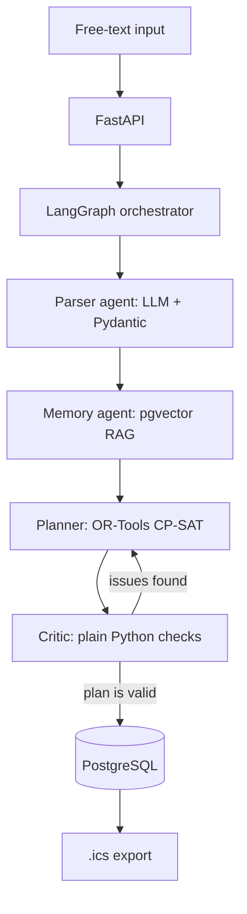

# agentic-day-planner
local-first multi-agent day planner: LangGraph + OR-Tools CP-SAT + pgvector, 100% free stack

## How it works

You write your day in plain language, for example *"Tomorrow I have 6 hours: study 2h, gym, call the dentist, grocery shopping"*, and the system returns an optimized schedule you can export to your calendar as `.ics`.

### Agents

| Agent | Role | Uses LLM? |
|-------|------|-----------|
| **Parser** | Extracts tasks, durations, priorities and deadlines from free text into validated Pydantic models (with automatic retry) | Yes |
| **Memory** | Retrieves user preferences and past days via embeddings and pgvector (e.g. "I study better in the morning") | Embeddings only |
| **Planner** | Builds the schedule with OR-Tools CP-SAT, so constraints are guaranteed, not hallucinated | No |
| **Critic** | Checks for overlaps, missing tasks and violated constraints; sends the plan back to the Planner if needed | No |

### Design choices

- **The solver does the hard part.** Scheduling is a constraint problem, so CP-SAT handles it and the LLM only parses text. This is why small local models (Qwen2.5 7B, Llama 3.2 3B) work well.
- **100% free and local-first.** Ollama for the LLM, PostgreSQL + pgvector in Docker, AWS emulated with LocalStack. Groq or Gemini free tiers are optional.
- **Model-agnostic.** A single LLM interface lets you switch models with one line in `.env`.